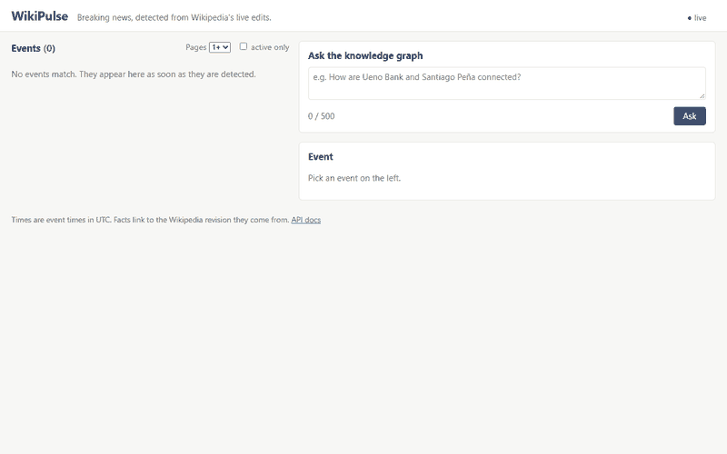
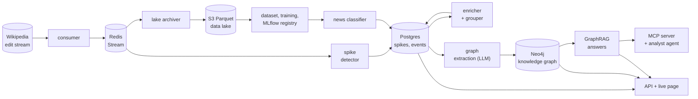

# WikiPulse

[](https://github.com/IoakeimKyrgiafinis/wikipulse/actions/workflows/ci.yml)

**Breaking news, detected from Wikipedia's live edits.** WikiPulse reads the stream of
every edit to English Wikipedia, notices pages that suddenly attract unusual editing
(usually because something just happened), groups them into stories, builds a knowledge
graph of the people, organizations and places involved with a local LLM, and answers
questions about it with GraphRAG, every claim citing the Wikipedia revision it came from.
Around that sits a full MLOps platform: a data lake, scheduled jobs, a news classifier
with a model lifecycle, Kubernetes, Helm, Terraform, monitoring and CI/CD. Everything
runs on a laptop, for free.



*The live page during the quickstart (pages filter set to 1+): events appear over the
WebSocket, without reloading, while a recorded day is replayed through the real pipeline.
Captured from headless Chrome in a fresh clone.*

## Try it in one command

You need [Docker Desktop](https://www.docker.com/products/docker-desktop/) (running) and
[uv](https://docs.astral.sh/uv/). No Wikimedia connection, no API keys, no Kubernetes.

```
git clone https://github.com/IoakeimKyrgiafinis/wikipulse.git
cd wikipulse
uv run python scripts/quickstart.py
```

It starts Redis, Postgres and Neo4j with Docker Compose, replays a bundled recording of
5 November 2026 (`demo/sample/`, 1.2 MB) through the real replay, detector, grouper and
API at 300 times real speed, and opens http://127.0.0.1:8000. In about seven minutes (five
of them the day itself) the day's 74 spikes appear on the page as about 70 events; most
have one page, so pick "Pages 1+" to see them all. The first run downloads the Docker
images, the Python packages and a small embedding model; after that it works without a
network. Ctrl+C stops it; `docker compose stop` stops the containers.

- `--graph` also fills the knowledge graph with a local LLM, so the events get headlines
  and entities. It needs [Ollama](https://ollama.com) with `ollama pull qwen3:4b`.
- `--speed 600` replays faster, `--no-browser` doesn't open the page.

The full system, live, needs a contact address in `.env` (Wikimedia's User-Agent policy)
and is started stage by stage: see [docs/usage.md](docs/usage.md).

## How it works



1. **Ingest.** One polite connection to Wikimedia's EventStreams; English Wikipedia
   article edits go into a Redis Stream, deduplicated and checkpointed atomically, so a
   crash loses or doubles nothing. Recordings can be replayed through the same code.
2. **Detect.** Per page, sliding 10- and 60-minute windows of human edits and distinct
   editors, compared with a decaying baseline of the page's normal rate and the daily
   rhythm. A spike starts at, for example, 5 edits by 3 people in 10 minutes, five times
   the expected count.
3. **Group.** Spikes about the same story become one event, scored on three signals:
   links between the pages, start times and the meaning of their summaries (embeddings).
4. **Understand.** A local LLM (qwen3:4b through Ollama) extracts each event's entities
   and relationships; names are linked to Wikidata; everything is stored in Neo4j with
   its source page and revision.
5. **Answer.** GraphRAG over three channels (graph traversal, one checked read-only
   Cypher query written by the LLM, vector search), served on a web page, a REST and
   WebSocket API, an MCP server for Claude Desktop, and an analyst agent that writes
   cited briefings.
6. **Operate.** Hourly Parquet archive, event-driven and scheduled jobs, a news
   classifier tracked in MLflow and retrained weekly, deployed with Helm and Terraform on
   a local Kubernetes cluster, with Prometheus, Grafana, Loki and a CI/CD pipeline whose
   eval gate blocks changes that make detection worse.

More: [docs/architecture.md](docs/architecture.md) (diagrams of every part, drawn from the
code).

## Tech stack

| Area | Tools |
|------|-------|
| Language and tooling | Python 3.12, uv, pydantic and pydantic-settings, pytest, ruff |
| Streaming and storage | Wikimedia EventStreams (SSE), Redis Streams, Postgres 16, Neo4j 5, S3 (RustFS), Parquet with pyarrow, DuckDB |
| AI | Ollama with qwen3:4b and qwen3:8b, sentence-transformers (bge-small), GraphRAG, the official MCP Python SDK, an agent loop without a framework |
| Product | FastAPI, WebSockets, a plain HTML, CSS and JavaScript page |
| ML lifecycle | scikit-learn, PyTorch (CPU), MLflow tracking and model registry, drift monitoring (PSI) |
| Batch | Airflow 3, S3 event notifications to a worker |
| Platform | Docker, Docker Compose, Kubernetes (kind), Helm, Terraform |
| Observability | Prometheus, Grafana, Loki, Alloy, structured JSON logs with correlation ids, Langfuse |
| CI/CD | GitHub Actions, Trivy, GHCR, a detection eval gate, a smoke install on kind |

## Results

Every number comes from a committed evaluation in [`evals/results/`](evals/results/) and
is explained in the stage's [learning note](docs/learning/). They are honest, small-sample
numbers from one laptop and a few recorded days, with their margins.

### Detection (spec 02b)

Two full days (5 and 6 November 2026), four threshold settings, against Wikipedia's
"Current events" portal and 50 LLM-labeled spikes per setting:

| Thresholds | Spikes | Recall of portal lead stories | Portal precision (lower bound) | Labeled precision (LLM, n = 50) | Time to detection, median |
|---|---:|---:|---:|---:|---:|
| strict | 53 | 0.0% | 7.5% | 54% | 9.4 min |
| default | 135 | 0.0% | 7.4% | 48% | 9.4 min |
| medium | 268 | 3.8% | 5.2% | 58% | 16.3 min |
| loose | 1,264 | 13.5% | 3.5% | 50% | 9.3 min |

About half of the spikes are news by the labels; the portal number is a floor because
most news on Wikipedia (election results, deaths, releases) never reaches the portal.
Recall is low for a structural reason: only 11 of the 52 portal lead stories received at
least 5 edits from 3 people *in total over three days*, so no editing-burst detector can
see the rest. The labels differ by less than their ±14 pp margin. The CI eval gate
(spec 09c) holds the default detector at precision 0.526 and recall 0.211 on a committed
16-hour recording.

### Grouping (spec 03b)

On 5 November, 665 spikes became 572 events; pairwise precision **78%** (±11.5 pp), recall
about **23%**, from 125 LLM-labeled page pairs. The biggest stories came out whole: 16
pages of the US gubernatorial elections, and the Paraguayan banking crisis (*Ueno Bank*,
*Pedro Alliana*, *Santiago Peña*, ...) as one event of five pages.

### Knowledge graph extraction (spec 04c)

233 events, 1,285 entities, 825 relations, qwen3:4b:

| Measure | Value |
|---|---:|
| Wikidata linking accuracy (484 linked names) | **95.9%** ± 1.8 pp |
| Relations Wikidata also has (a lower bound) | **31.9%** ± 4.0 pp |
| Labeled precision of relations (qwen3:8b judge, n = 50) | **93.9%** ± 6.7 pp |

Reading the judge's 50 verdicts by hand suggests about 80% precision: an 8B judge checks
"does the source mention this" well and "is the subject really the one doing it" poorly.
A second prompt (`extract_v2`) changed nothing beyond the noise, so the graph kept v1.

### Question answering (spec 05b)

25 fixed questions on a frozen copy of the graph, qwen3:8b, graded by an LLM judge
(qwen3:4b as a second judge agrees with linear-weighted kappa 0.82):

| Correctness (0 to 2) | Fully correct | Faithfulness | Entity recall | Correct refusals | Median latency |
|---:|---:|---:|---:|---:|---:|
| 1.20 | 48% | 95.9% | 92.3% | 80% | 4.8 s |

The system rarely invents facts (faithfulness 95.9%); its errors are in choosing,
counting and refusing. Four of the failures were LLM-written Cypher queries that never
ran, which the evaluation traced to the prompt and to a false positive in the query
validator.

### Analyst agent (spec 05d)

Five real briefings with every sentence cited and checked by a second model call; the
prompt-injection suite (planted instructions in page text) passed 8 of 9 cases before the
defense and 9 of 9 after it.

### News classifier: model comparison (spec 07b)

"Is this spike real news?", scored ten minutes after the spike starts, 43 features (plus
a summary embedding for the network), test split of 132 labeled spikes on later days:

| Model | Test average precision (95% interval) | ROC AUC | Precision / recall at its threshold |
|---|---|---:|---|
| the detector's rule alone | 0.614 (0.516 to 0.707) | 0.530 | 0.629 / 0.494 |
| logistic regression | 0.938 (0.898 to 0.970) | 0.903 | 0.872 / 0.861 |
| gradient-boosted trees | **0.958** (0.925 to 0.982) | 0.929 | 0.818 / 0.911 |
| neural network + summary embedding | 0.948 (0.911 to 0.977) | 0.920 | 0.897 / 0.772 |

A random ranking scores 0.598. The registry rule "simplest model not clearly worse" chose
logistic regression: the trees' lead of 0.020 has a paired 95% interval of -0.001 to
0.046. The labels are an LLM's, so these numbers measure agreement with qwen3:4b, not
with the truth. Weekly retraining in Airflow rejected an identical challenger, as it
should (gap +0.000), and drift monitoring found a real training/serving skew.

### Engineering checks

- Crash test of the consumer: killed hard mid-stream, **0 missing, 0 extra, 0 duplicates**
  of 487 events; the same on Kubernetes and for the lake archiver.
- Determinism: a replayed day gives the same spikes and events as the live run, also
  when stopped and restarted half way. The quickstart reproduces the offline detector's
  74 spikes of 5 November exactly.
- Data lake: an hour as zstd Parquet is 16.3% of the JSON size and queries about 15x faster.

## Design decisions and trade-offs

- **Event time everywhere.** Windows, baselines and "today" use the edits' timestamps,
  never the clock. It costs some care (a quiet stream doesn't end a spike until the next
  edit arrives) and buys exact replays: every evaluation, the CI gate and the quickstart
  run the production code on recordings.
- **Imperfect ground truth, measured from two sides.** The portal gives a certain but
  incomplete floor; LLM labels give a noisy estimate. Both are reported, with margins,
  and every label records who made it (`llm` or `human`; human labels always win).
- **Small local models, constrained hard.** qwen3:4b and 8b on a laptop GPU: JSON schemas
  for every structured answer, one LLM call per event (not per edit), Cypher checked
  before it runs, uncited sentences dropped, a second model call to verify briefings,
  and a hand-written agent loop with step, token and time budgets.
- **Stores between every stage.** Redis, Postgres, Neo4j and S3 decouple the processes:
  each can crash, restart or be replayed alone, and the web page shows an event seconds
  after detection and improves it in place when the slower LLM stages catch up.
- **The simplest model that isn't clearly worse.** Logistic regression over the boosted
  trees, decided by a paired bootstrap interval, not by the point estimate.
- **A laptop-sized platform.** Stateful services stay in Docker Compose, the cluster is
  disposable, and everything heavy (Airflow, MLflow, the eval graph) is behind a Compose
  profile. Nothing needs a cloud account.
- **Offline by default where possible.** CI, the smoke test and the quickstart never
  touch Wikimedia; the Helm chart has an offline overlay; a fake Wikimedia server stands
  in for the APIs.

## What I would do with more resources

- **Human labels.** All labels are LLM labels so far. A human pass over the 38 `news`
  labels of the CI gate, the classifier's test days and a QA sample would turn
  "agreement with qwen3" into real precision and recall.
- **Fix the training/serving skew** of the news classifier: build training rows from the
  live detector's spikes, anchored exactly as serving does (see the
  [roadmap's follow-ups](docs/ROADMAP.md#follow-ups)), and label new weeks automatically.
- **A vandalism signal.** 21 of 26 "not news" spikes in one sample were vandalism bursts;
  the share of reverted edits is the most promising detection feature.
- **Larger models and judges** for extraction and question answering (the 8B judge is the
  weakest link of the evaluation), and a fine-tuned small extraction model.
- **Better Cypher generation**: date arithmetic examples, exact name matching, and a fix
  for the validator's false positive found by the QA eval.
- **Other language editions** and real cloud deployment (the S3 and Terraform code only
  needs other endpoints).

## How it was built: with coding agents

WikiPulse was built spec by spec by Claude Code agents, with a human owner learning along
the way:

1. The owner wrote a [roadmap](docs/ROADMAP.md) and one spec per task in
   [`docs/specs/`](docs/specs/): goal, outputs, acceptance criteria, what's out of scope,
   and what the human should learn.
2. An implementer agent built each spec under the rules in [`AGENTS.md`](AGENTS.md)
   (event time, polite Wikimedia use, tests never touch the network, never weaken a test,
   every LLM call through one client) and ran every acceptance criterion itself.
3. A reviewer agent checked the work once; its reports are in
   [`docs/reviews/`](docs/reviews/), and one round of fixes followed.
4. Each spec ended with a [learning note](docs/learning/): what was built, the concepts
   explained with the project's own code, deviations from the spec and why, the measured
   results, and three self-test questions.

Twenty-seven specs, from the project skeleton to this README. The notes are the best way
to understand any part in depth; problems too big for their spec are listed as
[follow-ups](docs/ROADMAP.md#follow-ups).

Blog drafts built from the notes: [docs/blog/](docs/blog/).

## Repository map

| Path | What it holds |
|------|---------------|
| `wikipulse/` | The package: `stream`, `detect`, `enrich`, `events`, `graph`, `llm`, `qa`, `mcp_server`, `agent`, `api`, `lake`, `workers`, `jobs`, `ml`, `metrics`, `eval`, `db` |
| `scripts/` | The quickstart, cluster and infrastructure helpers, crash and determinism tests, fixture makers |
| `tests/` | Unit tests (no network, no Docker) and `integration`/`live` tests (opt in) |
| `evals/` | Evaluation results, labels and the CI gate's baseline |
| `demo/sample/` | The quickstart's recording |
| `charts/`, `k8s/`, `infra/`, `observability/`, `dags/`, `docker/` | Helm chart, raw manifests, Terraform, dashboards and alerts, Airflow DAGs, service images |
| `docs/` | Roadmap, specs, reviews, learning notes, architecture, usage, blog drafts |
