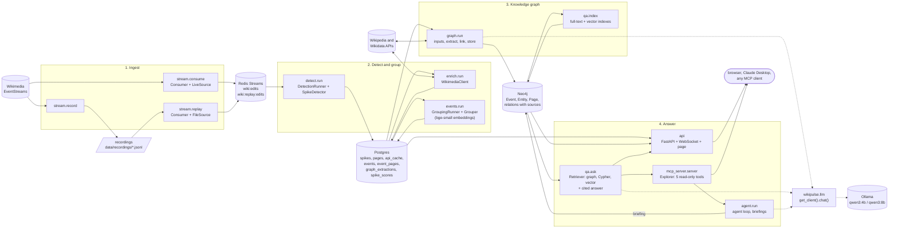
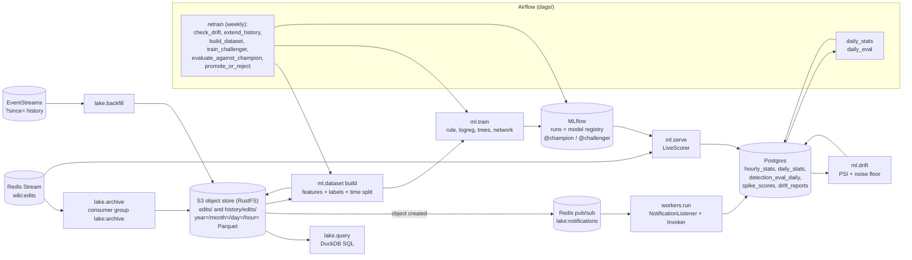
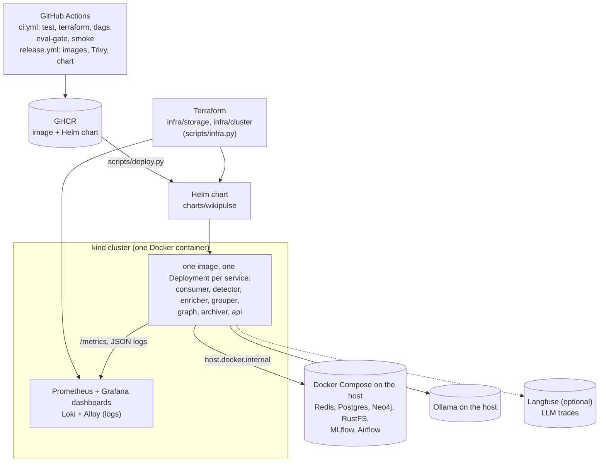
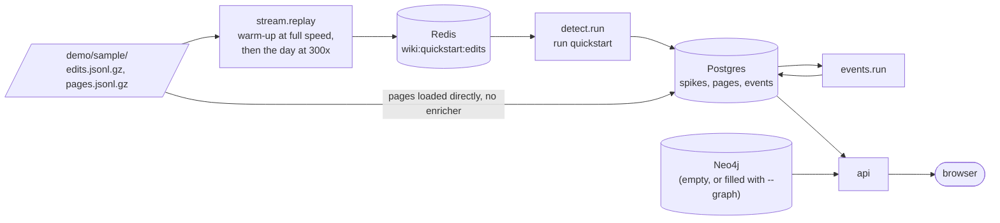

# Architecture

How WikiPulse fits together, drawn from the code as it is (spec 10). Each box names the
module you run (`uv run python -m <module>`) or the file that defines it; the learning
notes in [`docs/learning/`](learning/) explain each one in depth.

## The idea in one paragraph

Wikipedia publishes every edit as a live stream. When something happens in the world,
the pages about it suddenly get many edits from many people. WikiPulse reads the stream,
notices those **spikes**, groups spikes about the same story into **events**, has a local
LLM turn each event into a small **knowledge graph** (people, organizations, places and
how they relate, each fact citing a Wikipedia revision), and answers questions about it
with **GraphRAG**, through a web page, an API, an MCP server and an analyst agent. Around
that sits an MLOps platform: a data lake, batch jobs, a news classifier with a model
lifecycle, Kubernetes, Helm, Terraform, monitoring and CI/CD.

## The pipeline

Every arrow between processes goes through a store (Redis, Postgres, Neo4j, S3), never a
direct call, so each process can stop, restart or be replaced without the others noticing.

| Step | Module | Reads | Writes | Learning note |
|------|--------|-------|--------|---------------|
| Consume | `wikipulse.stream.consume` | EventStreams (SSE, one connection, `Last-Event-ID` resume) | `wiki:edits` (deduplicated, checkpointed atomically by a Lua script) | [01](learning/01-stream-consumer.md) |
| Record / replay | `wikipulse.stream.record`, `.replay` | the stream / a recording | a file / `wiki:replay:edits` through the same `Consumer.process` | [01](learning/01-stream-consumer.md) |
| Detect | `wikipulse.detect.run` | a Redis Stream (consumer group) | `spikes` | [02a](learning/02a-spike-detector.md), [02b](learning/02b-detection-eval.md) |
| Enrich | `wikipulse.enrich.run` | new spikes; Wikipedia Action and REST APIs (cached) | `pages`, `api_cache` | [03a](learning/03a-page-enrichment.md) |
| Group | `wikipulse.events.run` | spikes with their pages | `events`, `event_pages` | [03b](learning/03b-event-grouping.md) |
| Extract | `wikipulse.graph.run` | events, pages, burst text, Wikidata | Neo4j; `graph_extractions` | [04b](learning/04b-graph-extraction.md), [04c](learning/04c-extraction-eval.md) |
| Ask | `wikipulse.qa.ask` (`Retriever`, `answer`) | Neo4j (traversal, checked Cypher, vector search) | an answer with numbered citations | [05a](learning/05a-graph-retrieval.md), [05b](learning/05b-qa-evals.md) |
| MCP | `wikipulse.mcp_server.server` (`Explorer`) | Neo4j, the QA session | MCP tools, resource template, prompts | [05c](learning/05c-mcp-server.md) |
| Agent | `wikipulse.agent.run` (`agent/loop.py`) | the MCP tools, `read_page`, `related_events` | a cited briefing on the `Event` node; transcripts | [05d](learning/05d-analyst-agent.md) |
| Page | `wikipulse.api` (`EventReader`, `EventWatcher`) | Postgres (the list, seconds after detection), Neo4j (headlines, entities, briefings) | REST, WebSocket `/ws/events`, the page | [05e](learning/05e-api-and-web.md) |

All LLM calls go through `wikipulse.llm` ([04a](learning/04a-llm-client.md)): neutral
messages, tools and JSON schemas in, a backend (`ollama_backend.py`, optionally
`anthropic_backend.py`) out. Nothing else imports a provider's package.

## Batch, data lake and the model lifecycle

Notes [06a](learning/06a-data-lake.md), [06b](learning/06b-event-driven-worker.md),
[06c](learning/06c-scheduled-jobs.md), [07a](learning/07a-training-data.md),
[07b](learning/07b-news-classifier.md), [07c](learning/07c-serving-and-retraining.md).

## Deployment and operations

Notes [08a](learning/08a-kubernetes.md), [08b](learning/08b-helm-chart.md),
[08c](learning/08c-terraform.md), [09a](learning/09a-metrics-dashboards.md),
[09b](learning/09b-logging-tracing.md), [09c](learning/09c-cicd-pipeline.md).

The stateful services stay in Docker Compose and Ollama on the host: a 16 GB laptop can't
run them inside the cluster as well, and the cluster can be deleted and recreated without
losing data. The Helm chart's `values-offline.yaml` turns off the three services that call
Wikimedia (consumer, enricher, graph), which is how CI's smoke test and offline sessions
run.

## The quickstart path

`scripts/quickstart.py` runs the smallest useful part of the first diagram, offline:

Every Wikimedia URL of the processes it starts points at a local address, so nothing can
reach Wikimedia even by mistake. With `--graph`, the graph runner extracts each event with
the local LLM against `scripts/fake_wikimedia.py`, an offline stand-in that answers every
Wikimedia request with an empty result.

## Principles that hold everywhere

- **Event time, not wall-clock time.** Windows, baselines, spike lifecycles, event
  closing and "today" in questions all use the edits' own timestamps. A replayed
  recording gives exactly the same spikes and events as the live run (checked by
  `scripts/determinism_check.py` and the 03b replays).
- **At-least-once delivery, idempotent writes.** Consumer groups acknowledge only after
  the write; spikes, events, lake hours and graph extractions are upserts keyed on their
  identity, so a crash and restart repeats work but never doubles it.
- **One polite Wikimedia client.** One stream connection, a descriptive User-Agent,
  backoff, and caches (`api_cache`, `data/cache/`) in front of every API.
- **Every number has an eval.** Detection, grouping, extraction, question answering,
  prompt injection and the classifier each have a committed evaluation in
  `evals/results/`, and CI blocks a pull request that makes detection worse.
